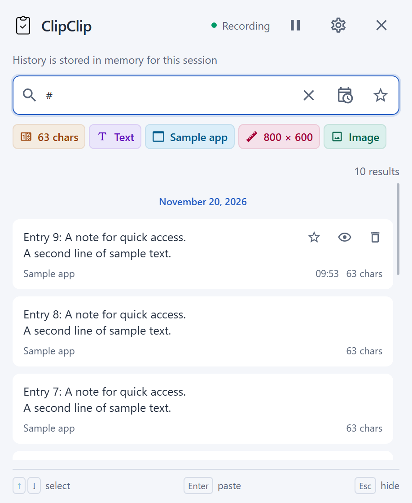

<p align="center"></p>
<h1 align="center">ClipClip Manager</h1>
<p align="center"><strong>English</strong> · <a href="README.ru.md" lang="ru">Русский</a></p>
<p align="center">Clipboard history with search, favorites, and keyboard shortcuts.<br>Keep text, links, images, and file paths on your device and paste them again when you need them.</p>
<p align="center">
  <a href="#quick-start">Quick start</a> ·
  <a href="#features">Features</a> ·
  <a href="#storage-and-backups">Storage</a> ·
  <a href="../../releases/latest">Latest version</a>
</p>

<p align="center">
  <picture>
    <source media="(prefers-color-scheme: dark)" srcset="assets/readme/history-en-dark.png">
    
  </picture>
</p>
<p align="center"><sub>English-language preview with tag suggestions and sample clipboard history.</sub></p>

## Quick start

1. In the ClipClip repository's **Releases** section, download and run `ClipClip-Windows-<version>-Setup.exe` for Windows x64. You can also [build the installer locally](#development-and-builds).
2. On first install, **Start ClipClip automatically when signing in to Windows** is selected by default. Clear the checkbox if you prefer to start the app manually.
3. Copy something in any app and press **Ctrl + Alt + B**. Type to search, choose an entry with the arrow keys, and press **Enter**. On Windows, with automatic paste enabled, ClipClip returns focus to the previous window and pastes the entry. If automatic paste is unavailable, the entry stays on the clipboard.

When startup is enabled, ClipClip appears in the system tray at sign-in. You can turn it off in **Settings → Apps → Startup**. Updates preserve your choice. The × button hides the window while ClipClip continues recording. To close the app, select **Exit** (**Выход**) from the tray menu.

## Features

- **Search and filters.** Search by text, source app, entry type, or `#tag`. Narrow results by date, time, or favorites. Search recognizes both Russian and English terms, such as `#текст` and `#text`.
- **Favorites and history.** Star an entry to pin it at the top. The newest entry is selected and the search field gets focus when you open ClipClip. You can move copied entries to the top automatically and pause clipboard recording.
- **Preview and edit.** Browse entries of the same type in compact or full-screen preview. Zoom and pan images, edit text with autosaved revisions, or restore the original. Select a tag in preview to filter the history.
- **Files and colors.** Check whether a file is available, copy its path, or show it in File Explorer. Convert and copy recognized colors in another format.

### Keyboard shortcuts

| Action | Default shortcut |
| --- | --- |
| Open ClipClip | <kbd>Ctrl</kbd> + <kbd>Alt</kbd> + <kbd>B</kbd> |
| Select an entry | <kbd>↑</kbd> / <kbd>↓</kbd> |
| Copy or paste the selected entry | <kbd>Enter</kbd> |
| Open preview | <kbd>Ctrl</kbd> + <kbd>Enter</kbd> |
| Toggle favorite | <kbd>Ctrl</kbd> + <kbd>D</kbd> |
| Delete the selected entry from the list | <kbd>Delete</kbd> |
| Pause or resume recording | <kbd>Ctrl</kbd> + <kbd>Shift</kbd> + <kbd>P</kbd> |
| Clear the search and filters, then hide the window | <kbd>Esc</kbd> |

Change shortcuts in the **Keyboard shortcuts** (**Горячие клавиши**) tab. On Windows, the default shortcut uses the physical **B/И** key. In preview, **Ctrl + F** toggles full screen and **Esc** returns to compact view. Use **Ctrl + scroll** to zoom an image.

## Storage and backups

ClipClip uses your operating system's encryption to store history locally in `history.enc`. If secure encryption is unavailable, history stays in memory until you quit. Clipboard content stays out of logs.

On Windows, the app you copy from can mark an individual item to keep it out of Windows clipboard history. ClipClip checks for this flag before reading the item and skips flagged items. You can still paste the item with **Ctrl + V**. For example, a copied password stays out of ClipClip history if the password manager sets the flag when you copy it.

| Limit | Value |
| --- | --- |
| Regular history | 100 entries by default, configurable from 1 to 10,000 |
| Total history, including favorites | 32 MB |
| Individual entry | 8 MB |
| Individual image | 16 megapixels |
| JSON import file | 256 MB |

Favorites count toward the total storage limit and have no effect on the regular entry count. You can undo individual deletions for 10 seconds. **Clear all history** removes every entry, including favorites, after confirmation.

In **Settings → General** (**Настройки → Основные**), you can export history, favorites, and settings as unencrypted JSON. The export stores images as PNG data URLs and files and folders as paths. Import merges entries by content and lets you choose whether to apply settings from the file. If the merge would remove any existing entries, ClipClip asks for confirmation. Import and export preserve the current contents of the system clipboard.

<details>
<summary>Backup format and source detection</summary>

- The [backup schema](shared/backup.ts) describes the `clipclip-backup` format. It versions `manifestVersion` independently of `appVersion`, and `history` contains [ClipboardHistoryItem](shared/clipboard.ts) records. An invalid JSON file, an unknown format version, or a limit violation stops the import before any changes to history.
- During a merge, matching entries keep their existing IDs and favorite status. Favorites take priority when the total storage limit is reached. An unavailable shortcut or a write failure in the available encrypted store cancels the import.
- ClipClip estimates the source when reading the clipboard. For images on Windows, the app records the clipboard owner on a clipboard-change notification when possible. The source tag identifies the app that copied the image.

</details>

## Development and builds

Node.js 24 is recommended, with 22.12 as the minimum. ClipClip uses Electron, Vue 3, Pinia, Vue Router, and Tailwind CSS.

```sh
npm ci
npm run dev
```

| Build | Command |
| --- | --- |
| NSIS installer for Windows x64 | `npm run build:win` |
| Portable app for Windows | `npm run build:win-portable` |
| DMG for macOS | `npm run build:mac` |
| AppImage for Linux | `npm run build:linux` |

Local packages are written to `release/<version>`. Use these builds for local use and testing.

<details>
<summary>Developer checks</summary>

```sh
npm run typecheck
npm test
npm run build:app
npm run test:electron
npm audit
```

`npm run test:electron` uses a test clipboard and an isolated profile. It saves screenshots to `test-results`. On Linux, run it in a graphical session or use `xvfb-run -a npm run test:electron`. Use `npm run test:electron -- --hidden` to check hidden startup on Windows.

The dev server runs at `http://127.0.0.1:3344`. Set `CLIPCLIP_DEVTOOLS=1` to open DevTools. Packaged builds load the UI over the local `app://` protocol. The native `get-windows` module ships with N-API binaries.

</details>

## Windows releases

Enable **GitHub Actions** in the public ClipClip repository. If `git remote -v` shows `electron-vite/electron-vite-vue`, that remote points to the upstream template. Push release tags to your ClipClip repository. This example uses a remote named `clipclip`.

Choose an unused version higher than the last published release. The command updates both `package.json` and `package-lock.json`.

```sh
npm version 2.0.1 --no-git-tag-version
```

Commit the changes, create a matching tag, and push it to GitHub.

```sh
git tag v2.0.1
git push clipclip v2.0.1
```

The [**Release Windows installer** workflow](.github/workflows/release-windows.yml) builds NSIS x64 and publishes `ClipClip-Windows-<version>-Setup.exe`, its `.exe.blockmap`, and `latest.yml`. The workflow uses its own repository as the source for automatic updates.

Install the first release that supports automatic updates manually from GitHub Releases. ClipClip checks stable releases at launch and every 6 hours, downloads updates in the background, and installs them when you exit. To update the portable edition, replace the old executable with the new download.

### Installer signing

The workflow reads two GitHub Actions repository secrets for Authenticode signing.

- `WIN_CSC_LINK` is the Base64-encoded PFX file with the private key.
- `WIN_CSC_KEY_PASSWORD` is the PFX password.

For tests, you can create a self-signed certificate of type `CodeSigningCert`. Configure test machines to trust its public certificate. A publicly trusted signature requires a certificate that chains to a trusted Windows root or a signing service. Use the same publisher across signed updates. [electron-builder signing setup](https://www.electron.build/v26/docs/features/code-signing/#windows-specific-variables) · [Windows signing options](https://learn.microsoft.com/en-us/windows/apps/package-and-deploy/code-signing-options)

## License

ClipClip is available under the [MIT License](LICENSE). Component licenses are available in the app's **About** (**О программе**) tab. See [AGENTS.md](AGENTS.md) for repository guidelines.
