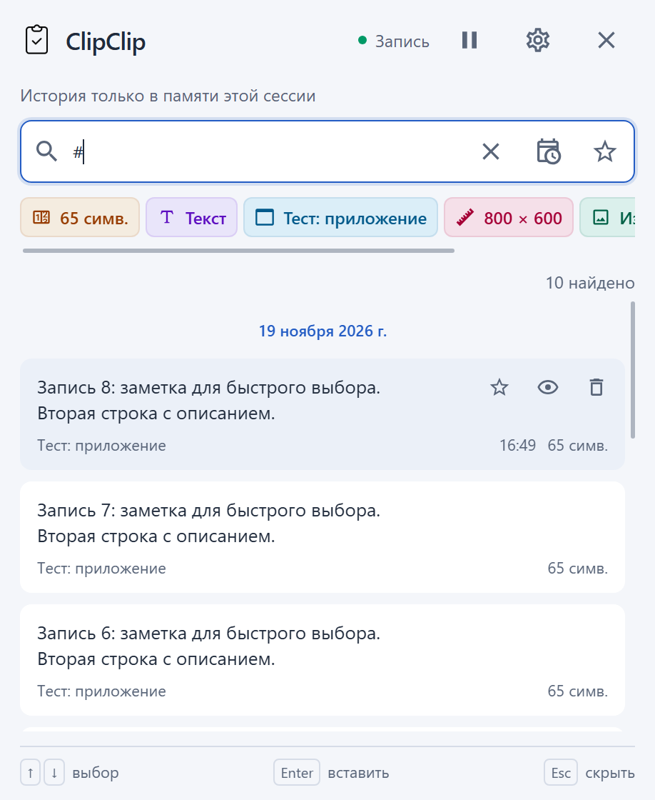

<p align="center"></p>
<h1 align="center">ClipClip Manager</h1>
<p align="center"><a href="README.md" lang="en">English</a> · <strong>Русский</strong></p>
<p align="center">История буфера обмена с поиском, избранным и вставкой по горячей клавише.<br>Тексты, ссылки, изображения и пути к файлам сохраняются локально.</p>
<p align="center">
  <a href="#быстрый-старт">Быстрый старт</a> ·
  <a href="#возможности">Возможности</a> ·
  <a href="#хранение-и-резервные-копии">Хранение</a> ·
  <a href="../../releases/latest">Последняя версия</a>
</p>

<p align="center">
  <picture>
    <source media="(prefers-color-scheme: dark)" srcset="assets/readme/history-dark.png">
    
  </picture>
</p>
<p align="center"><sub>Окно ClipClip с тестовой историей и подсказками поиска по меткам.</sub></p>

## Быстрый старт

1. В разделе **Releases** репозитория ClipClip скачайте `ClipClip-Windows-<версия>-Setup.exe` для Windows x64 и запустите его. Также можно [собрать установщик локально](#разработка-и-сборка).
2. При первой установке флажок **«Запускать ClipClip автоматически при входе в Windows»** установлен по умолчанию. Снимите его, если предпочитаете запускать приложение вручную.
3. Скопируйте что-нибудь в любом приложении и нажмите **Ctrl + Alt + B**. Начните печатать для поиска, выберите запись стрелками и нажмите **Enter**. На Windows при включённой автоматической вставке ClipClip возвращает фокус предыдущему окну и вставляет запись. Если вставка недоступна, запись остаётся в буфере.

С включённым автозапуском ClipClip появляется в трее при входе в Windows. Отключить его можно в разделе **Параметры → Приложения → Автозагрузка**. Обновления сохраняют ваш выбор. Кнопка × скрывает окно, запись истории продолжается. Для завершения работы используйте **«Выход»** в меню значка ClipClip.

## Возможности

- **Поиск и фильтры.** Ищите по тексту, приложению-источнику, типу записи или `#метке`. Можно сузить выдачу по дате, времени или избранному. Поиск понимает русские и английские названия, например `#текст` и `#text`.
- **Избранное и история.** Звёздочка закрепляет запись сверху. Новое окно открывается на самой свежей записи, а поле поиска сразу получает фокус. В настройках можно автоматически поднимать повторно скопированные записи и приостанавливать сбор истории.
- **Просмотр и редактирование.** Листайте записи одного типа в полноэкранном или компактном просмотре. Для изображений доступны масштаб и перемещение, для текста — редактирование, автосохранение версий и возврат к оригиналу. Метка в просмотре открывает соответствующий фильтр истории.
- **Файлы и цвета.** У записей с файлами можно проверить доступность, скопировать путь или показать файл в Проводнике. Распознанные цвета можно перевести в другой формат и скопировать.

### Горячие клавиши

| Действие | По умолчанию |
| --- | --- |
| Открыть ClipClip | <kbd>Ctrl</kbd> + <kbd>Alt</kbd> + <kbd>B</kbd> |
| Выбрать запись | <kbd>↑</kbd> / <kbd>↓</kbd> |
| Скопировать или вставить выбранное | <kbd>Enter</kbd> |
| Открыть просмотр | <kbd>Ctrl</kbd> + <kbd>Enter</kbd> |
| Переключить избранное | <kbd>Ctrl</kbd> + <kbd>D</kbd> |
| Удалить выбранное из списка | <kbd>Delete</kbd> |
| Приостановить или продолжить запись | <kbd>Ctrl</kbd> + <kbd>Shift</kbd> + <kbd>P</kbd> |
| Сбросить поиск и фильтры, затем скрыть окно | <kbd>Esc</kbd> |

Во вкладке **«Горячие клавиши»** можно изменить сочетания. На Windows стандартный вызов привязан к физической клавише **B/И**. В просмотре **Ctrl + F** переключает полноэкранный режим, а **Esc** возвращает компактное окно. Для увеличения изображений используйте **Ctrl + колесо**.

## Хранение и резервные копии

ClipClip шифрует историю средствами ОС и хранит её локально в `history.enc`. Если безопасное шифрование недоступно, история остаётся в памяти до выхода. Содержимое буфера не попадает в журналы.

В Windows приложение, из которого вы копируете данные, может пометить конкретную запись как исключённую из системной истории буфера обмена. ClipClip проверяет эту метку перед чтением и пропускает помеченную запись. Её по-прежнему можно вставить через **Ctrl + V**. Например, скопированный пароль не попадёт в историю ClipClip, если менеджер паролей поставит эту метку при копировании.

| Ограничение | Значение |
| --- | --- |
| Обычная история | 100 записей по умолчанию, от 1 до 10 000 в настройках |
| Вся история с избранным | 32 МБ |
| Одна запись | 8 МБ |
| Одно изображение | 16 мегапикселей |
| Файл импорта JSON | 256 МБ |

Избранное хранится сверх лимита обычных записей и учитывается в общем объёме. Удаление отдельной записи можно отменить в течение 10 секунд. **«Очистить всю историю…»** удаляет историю вместе с избранным после подтверждения.

В **Настройки → Основные** можно экспортировать историю, избранное и настройки в незашифрованный JSON. Изображения записываются в PNG data URL, файлы и папки — как пути. Импорт объединяет записи по содержимому и позволяет отдельно применить настройки из файла. При необходимости вытеснить существующие записи приложение сначала запрашивает подтверждение. Импорт и экспорт сохраняют текущее содержимое системного буфера.

<details>
<summary>Формат резервной копии и определение источника</summary>

- Формат `clipclip-backup` описан в [схеме резервной копии](shared/backup.ts). Поле `manifestVersion` версионируется независимо от `appVersion`, а `history` содержит записи [ClipboardHistoryItem](shared/clipboard.ts). Некорректный JSON, неизвестная версия формата или превышение лимитов отклоняют файл до изменения истории.
- При объединении сохраняются идентификаторы и отметки избранного у совпавших записей. Избранные записи имеют приоритет при достижении общего лимита. Неверная горячая клавиша или сбой записи в доступное зашифрованное хранилище отменяет импорт.
- ClipClip определяет источник приблизительно во время чтения буфера. Для изображений в Windows приложение по возможности запоминает окно-владельца буфера при получении уведомления. Метка относится к приложению, записавшему изображение в буфер.

</details>

## Разработка и сборка

Рекомендуется Node.js 24, минимум — 22.12. Приложение использует Electron, Vue 3, Pinia, Vue Router и Tailwind CSS.

```sh
npm ci
npm run dev
```

| Задача | Команда |
| --- | --- |
| Установщик NSIS для Windows x64 | `npm run build:win` |
| Portable-версия для Windows | `npm run build:win-portable` |
| DMG для macOS | `npm run build:mac` |
| AppImage для Linux | `npm run build:linux` |

Локальные пакеты сохраняются в `release/<версия>`. Сборки из этого раздела предназначены для локального использования и проверки.

<details>
<summary>Проверки для разработчиков</summary>

```sh
npm run typecheck
npm test
npm run build:app
npm run test:electron
npm audit
```

`npm run test:electron` использует тестовый буфер и изолированный профиль. Скриншоты сохраняются в `test-results`. На Linux запускайте проверку в графической сессии или через `xvfb-run -a npm run test:electron`. Сценарий скрытого старта на Windows проверяется командой `npm run test:electron -- --hidden`.

Dev-сервер работает на `http://127.0.0.1:3344`. Для DevTools задайте `CLIPCLIP_DEVTOOLS=1`. В сборке интерфейс загружается по локальному протоколу `app://`. Нативный `get-windows` использует поставляемые N-API-бинарники.

</details>

## Выпуск версий Windows

Включите **GitHub Actions** в публичном репозитории ClipClip. Если `git remote -v` показывает `electron-vite/electron-vite-vue`, этот адрес ведёт на исходный шаблон. Отправляйте теги в собственный репозиторий ClipClip. В примере он настроен как remote `clipclip`.

Выберите свободную версию выше предыдущего опубликованного релиза. Команда обновит `package.json` и `package-lock.json`.

```sh
npm version 2.0.1 --no-git-tag-version
```

Закоммитьте изменения, создайте тег с той же версией и отправьте его на GitHub.

```sh
git tag v2.0.1
git push clipclip v2.0.1
```

[Workflow **Release Windows installer**](.github/workflows/release-windows.yml) собирает NSIS x64 и публикует `ClipClip-Windows-<версия>-Setup.exe`, его `.exe.blockmap` и `latest.yml`. Адрес GitHub Releases для автообновлений определяется по репозиторию, где запущен workflow.

Первую версию с автообновлением пользователь устанавливает вручную из GitHub Releases. ClipClip проверяет стабильные релизы при запуске и каждые 6 часов, скачивает обновление в фоне и применяет его при выходе из приложения. Portable-версия обновляется заменой скачанного файла.

### Подпись установщика

Для Authenticode-подписи workflow принимает секреты репозитория GitHub Actions.

- `WIN_CSC_LINK` — PFX с закрытым ключом, закодированный в Base64.
- `WIN_CSC_KEY_PASSWORD` — пароль PFX.

Для тестирования можно выпустить самоподписанный сертификат типа `CodeSigningCert`. На тестовых машинах потребуется явно настроить доверие к его публичному сертификату. Для публичного релиза с доверенной подписью нужен сертификат с цепочкой доверия Windows или сервис подписи. В подписанных обновлениях используйте того же издателя. [Настройка electron-builder](https://www.electron.build/v26/docs/features/code-signing/#windows-specific-variables) · [Варианты подписи Windows](https://learn.microsoft.com/en-us/windows/apps/package-and-deploy/code-signing-options)

## Лицензия

ClipClip распространяется по [лицензии MIT](LICENSE). Тексты лицензий компонентов доступны в приложении на вкладке **«О программе»**. Правила работы с репозиторием описаны в [AGENTS.md](AGENTS.md).
